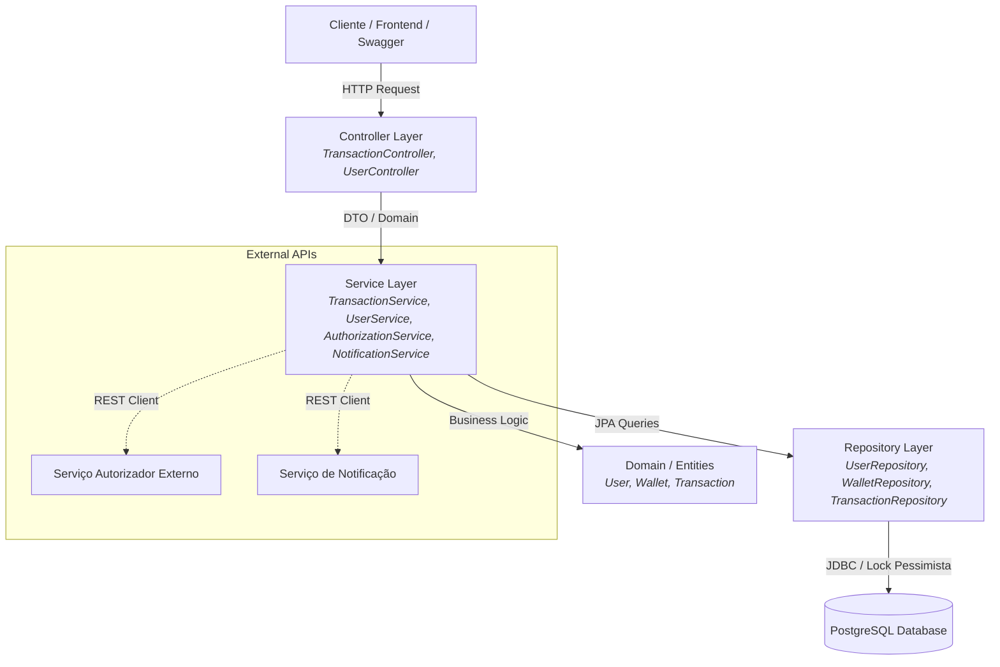

# Transação Simplificada API

Este projeto consiste na implementação de uma plataforma de pagamentos simplificada que permite o cadastro de contas e a realização de transferências financeiras entre usuários comuns e lojistas.

## 🚀 Tecnologias Utilizadas

- **Java 21**
- **Spring Boot 4.1.2** (Sem utilização de Lombok)
- **Spring Data JPA**
- **PostgreSQL**
- **Docker & Docker Compose**
- **Springdoc OpenAPI (Swagger)**
- **JUnit 5 & Mockito** (Testes Unitários)
- **RestAssured** (Testes de Integração)

## 🏗️ Arquitetura e Boas Práticas

A aplicação foi estruturada seguindo o padrão de **Arquitetura em Camadas** combinada com conceitos de **Domain-Driven Design (DDD)** para manter um modelo de domínio rico.

- **Encapsulamento Rígido:** Regras de saldo como débito e crédito estão isoladas na entidade `Wallet`, evitando o antipadrão de modelo anêmico.
- **SOLID:** Princípios de Responsabilidade Única (SRP) e Inversão de Dependência foram aplicados na separação de serviços (`TransactionService`, `AuthorizationService`, `NotificationService`).
- **Consistência e Concorrência:** Implementado Lock Pessimista de Escrita (`PESSIMISTIC_WRITE`) nas consultas de saldo para prevenir condições de corrida (*Race Conditions*) no banco de dados.
- **Segurança de Dados:** Uso de DTOs de entrada e saída para evitar exposição de dados sensíveis como senhas.

### 📊 Diagrama de Arquitetura em Camadas



## 📦 Como Executar o Projeto

### Pré-requisitos
- **Java 21 (JDK)** instalado.
- **Docker** e **Docker Compose** instalados.

### Passo a Passo
1. Clone o repositório.
2. Na raiz do projeto, execute o comando para subir o banco de dados:
   ```bash
   docker-compose up -d
   ```
3. Execute a aplicação através da sua IDE de preferência ou via terminal:
   ```bash
   ./mvnw spring-boot:run
   ```

## 🧪 Testes Automatizados

O projeto possui duas frentes de testes automatizados para garantir a estabilidade e conformidade das regras de negócio:

### 1. Testes Unitários
Focados em validar isoladamente os comportamentos do `TransactionService` (como verificação de saldo, lojista enviando dinheiro, recusa do serviço autorizador externo).
```bash
./mvnw test
```

### 2. Testes de Integração (RestAssured)
Validam o ciclo completo da aplicação subindo o contexto HTTP real em porta randômica (`@SpringBootTest`) e integrando com o banco de dados PostgreSQL.
- **Classe principal:** `TransactionControllerIT`
- **Cenários cobertos:**
  - Transferência com sucesso entre usuários comuns (`201 Created`).
  - Bloqueio de transferência quando o remetente é um lojista (`400 Bad Request`).
  - Validação de saldo insuficiente (`400 Bad Request`).

Para rodar os testes de integração com o banco ativo no Docker:
```bash
./mvnw test -Dtest=TransactionControllerIT
```

## 📖 Documentação Interativa (Swagger)
Com a aplicação rodando, acesse a interface do Swagger pelo navegador para explorar e testar todos os endpoints:
👉 `http://localhost:8080/swagger-ui.html`

> **Dica:** Você também pode utilizar o arquivo `api-tests.http` na raiz do projeto para executar os cenários prontos diretamente pelo IntelliJ IDEA ou VS Code.

## 🛠️ Como Testar os Endpoints via cURL

### 1. Criar Usuário Comum (com saldo inicial)
```bash
curl -X POST http://localhost:8080/users \
  -H "Content-Type: application/json" \
  -d '{
    "fullName": "Luiz Dev Comum",
    "document": "12345678901",
    "email": "luiz.comum@email.com",
    "password": "senhaSegura123",
    "userType": "COMMON",
    "wallet": { "balance": 500.00 }
  }'
```

### 2. Criar Usuário Lojista
```bash
curl -X POST http://localhost:8080/users \
  -H "Content-Type: application/json" \
  -d '{
    "fullName": "Loja de Eletronicos LTDA",
    "document": "98765432000199",
    "email": "contato@loja.com",
    "password": "senhaLojista456",
    "userType": "MERCHANT"
  }'
```

### 3. Efetuar uma Transferência
```bash
curl -X POST http://localhost:8080/transfer \
  -H "Content-Type: application/json" \
  -d '{"value": 100.0, "payer": 1, "payee": 2}'
```
